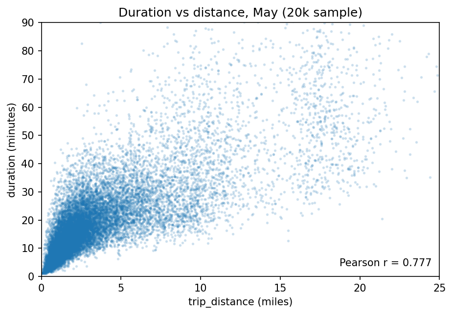
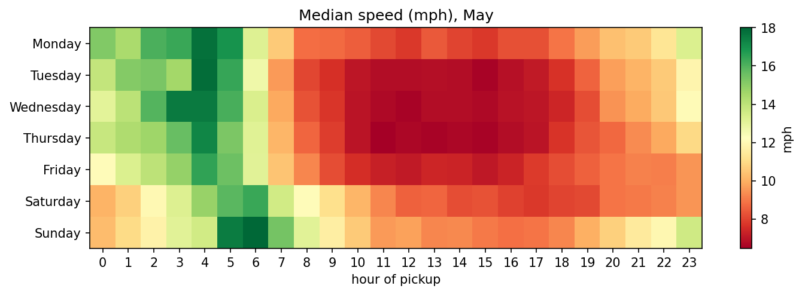
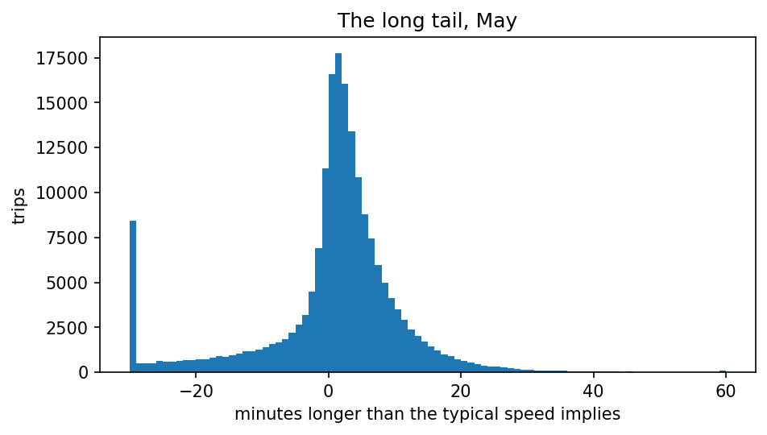
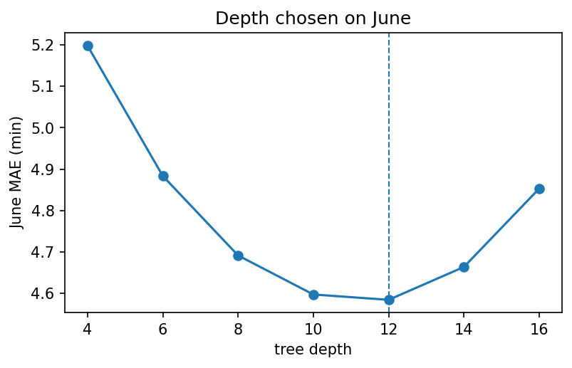
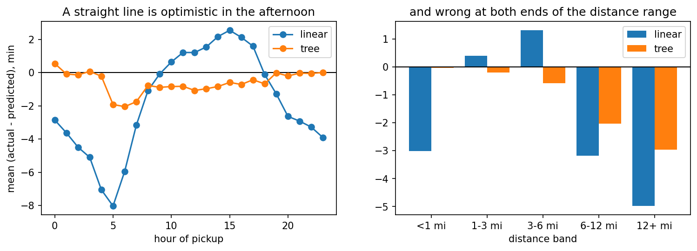
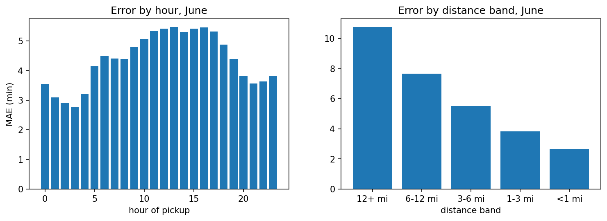

# How long will this trip take?

Team B · New York yellow taxi trips, May–July 2026 · regression, predicted at
pickup.

Figures are written by `src.evaluate.save_figure` and live in `figures/`, so
every one can be regenerated by running the notebooks.

## What was asked

A passenger has just got into a taxi. The app shows them an arrival time.
Arriving later than shown costs them whatever they planned around it;
arriving earlier costs them a wait. So the app shows an estimate **plus a
buffer**, and the project is as much about sizing that buffer as about the
point estimate.

The target is the duration in minutes between the two meter timestamps. The
metric is MAE, with RMSE alongside to show what the long tail does.

## What the data is, and what was wrong with it

600,000 trips, 200,000 per month, published raw. **6.08% of rows were
removed** and the reasons are counted one by one in
`notebooks/02-clean-and-split.ipynb`:

- 7,676 trips with a duration of zero — no negative ones at all in this sample
- 6,407 more under a minute, 180 over three hours
- 19,500 with zero distance, of which 14,807 still ran over a minute: the
  meter ran and measured nothing
- distances up to 317,000 miles — meter faults, not journeys
- 3,771 trips through zones 264/265, which have no borough and no geography
- no voided trips at all, which the findings table records rather than
  assuming

Three decisions were required of every team, and two of them cut against the
obvious move:

- **Flex fare trips stay in.** A quarter of the sample, with no passenger
  count. Dropping them would have answered a narrower question than the one
  asked; the missing column is imputed inside the pipeline instead.
- **Non-standard rate codes stay in, unfiltered.** `RatecodeID` is set at the
  *end* of the trip. Using it to remove training rows would shape the training
  population with knowledge the model will never have at pickup — a leak no
  metric would catch. It appears only as a reporting slice.
- **Negative amounts are flagged, not dropped.** They mark refunds and
  corrections, and they say nothing about the clock.

The split is by pickup month — May 189,024, June 187,549, July 186,951 — not
by a random shuffle, because the model will always run on a month it has not
seen.

## What the analysis says

Distance explains a great deal and is nowhere near sufficient: inside the
1–3 mile band alone, the 10th and 90th percentiles of duration are minutes
apart. That spread is the room a model has to work in.

The city has a daily rhythm, and it is the strongest thing knowable at pickup
besides the distance: median speeds roughly halve between the small hours and
the mid-afternoon. Boroughs differ sharply, and airport trips are their own
animal — long, comparatively fast, and few.

The long tail is concentrated in the slow hours and in Manhattan, and nothing
knowable at pickup explains the worst of it. That is the argument for a
buffer rather than a better point estimate.

## What was built

A pipeline that cannot leak by construction: an allow-list of columns
knowable at pickup, plus a deny-list that raises on anything settled at the
end of the trip. Every learned step — imputers, scaler, encoder — sits inside
the `ColumnTransformer` and is fitted on May only.

Features were added one at a time and judged on June:

| Addition | June MAE | Change |
|---|---|---|
| Distance only | 5.344 | — |
| + clock (hour, day, minutes into day, weekend) | 4.761 | **−0.583** |
| + boroughs | 4.692 | −0.069 |
| + airport flags | 4.691 | −0.001 |
| + passenger count | 4.691 | 0.000 |

The clock is almost the whole gain. **Airport flags and passenger count did
not pay for themselves** and are reported here rather than quietly kept or
quietly dropped; they remain in the feature set because they cost nothing and
make the airport slice interpretable, which is a choice, not a result.

Three features were tried and rejected: the pickup zone instead of the borough
(+0.011 MAE, 260 categories for nothing), distance squared (no change, since
a tree does not care), and the day of the month (+0.027 — a feature with no
reason behind it, which duly made things worse).

## What it scores

| Rung | June MAE | RMSE |
|---|---|---|
| Median of May | 8.86 | 13.15 |
| Distance ÷ typical speed (8.96 mph) | 9.67 | 18.52 |
| Tree, depth 2 | 6.02 | 8.40 |
| Linear regression | 5.64 | 8.04 |
| **Tree, depth 12** | **4.58** | **6.97** |

The hand-written rule is *worse* than the median on MAE — one typical speed
badly overestimates long trips — but far better on buffer, 7.6 minutes
against 18.3. Which model looks best depends on which question is asked of it.

July, scored once: **MAE 4.677 [4.654, 4.703]** against the median baseline's
8.490 [8.449, 8.525]. The intervals do not overlap.

Where a straight line fails: linear regression is optimistic by 2.5 minutes in
the mid-afternoon and pessimistic by 8 minutes at 05:00, because it has to
price every mile the same at every hour. The tree holds its hourly bias inside
±1 minute. Both overestimate the longest trips.

## The buffer, and who it is too small for

June chose **6.7 minutes**, and on July it delivered **92.4%** coverage
against the 90% promised. Without it, only 59.6% of passengers arrive before
the time shown.

One global buffer does not keep one promise:

| Group | n | Coverage it gets |
|---|---|---|
| Queens | 15,290 | **83%** |
| 15:00–17:00 | ~32,700 | 87% |
| Manhattan | 166,429 | 91% |
| 02:00–06:00 | ~9,600 | 95–97% |

Queens is where the airports are, and airport trips are the hardest slice in
the data (MAE 8.62, needing an 11.8 minute buffer). The app promises 90% and
delivers 83% to those passengers.

## What to do about it

1. Replace `trip_distance` with a routing estimate. Everything above rests on
   a distance the meter recorded *after* the trip, which no app has at pickup.
2. Set the buffer per distance band or per hour. The slice tables show that a
   single number cannot keep the same promise to Queens and to Manhattan.
3. Nothing derived from the fare, the total or the rate code — those are the
   answer in disguise, and the pipeline raises if one is passed in.
